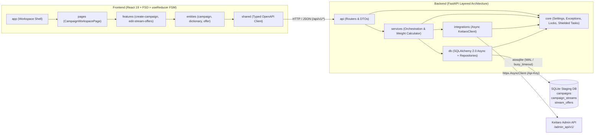

[English](README.en.md) | [Русский](README.ru.md)

# Adrobot — Keitaro Campaign Creator & Stream Staging Editor

**Adrobot** is a full-stack campaign automation and offer-stream staging platform built for the **Keitaro Admin API (`/admin_api/v1/`)**. It provides a deterministic, two-stream campaign creation workflow (**Создаватор**) and a local-first staging editor (**Редактор**) for managing offer rotations, pinning traffic weights, archiving/restoring offers, and atomically pushing verified traffic shares back to Keitaro.

---

## 1. Overview & Architecture

Adrobot is structured as an async modular monolith backend (**Python 3.12+ / FastAPI / SQLAlchemy 2.0 / Pydantic v2 / HTTPX**) paired with a **React 19 / TypeScript / Vite 6** single-page application organized under **Feature-Sliced Design (FSD)**.



### Strict Architectural Boundaries
- **Backend (`backend/src/adrobot/`):**
  - `api` -> `services`, `core` (FastAPI routers perform zero direct DB queries or HTTP calls).
  - `services` -> `integrations`, `db`, `core` (pure domain orchestration, weight rebalancing, and shielded consistency).
  - `integrations` -> `core` (typed `KeitaroClient` with trailing-slash base URL normalization and secret encapsulation via `pydantic.SecretStr`).
  - `db` -> `core` (SQLAlchemy 2.0 async models and repositories using explicit `select()` / `selectinload()` with zero implicit lazy loading).
  - `core` -> standard library & third-party utilities only.
- **Frontend (`frontend/src/`):**
  - Enforced via `eslint-plugin-boundaries` (`app -> pages -> widgets -> features -> entities -> shared`).
  - Complex UI lifecycles are modeled with deterministic `useReducer` finite state machines (`idle | loading | submitting | ready | error`) rather than ad-hoc boolean flags.
  - API payloads are strictly typed from FastAPI's OpenAPI schema (`src/shared/api/schema.d.ts`).

### Local Staging Database Schema
1. **`campaigns`**: Tracks managed campaigns (`keitaro_campaign_id`, `name`, `alias`, `geo`, `domain_id`, `group_id`, `traffic_source_id`).
2. **`campaign_streams`**: Tracks streams belonging to a campaign (`keitaro_stream_id`, `name`, `position`, `stream_type`, `schema`, `action_type`, `action_payload`, `has_offers`, `is_dirty`).
3. **`stream_offers`**: Tracks staged and published offer states within a stream (`keitaro_offer_id`, `offer_name`, `share`, `is_pinned`, `status` [`active` | `removed`], `is_published`, `published_share`, `published_status`), with a unique constraint on `(stream_id, keitaro_offer_id)`.

---

## 2. Key Business & Staging Mechanics

### A. Campaign Creation Flow ("Создаватор")
Creating a campaign (`POST /api/v1/campaigns`) executes a 3-step sequence against Keitaro inside a shielded task (`run_shielded`) so client disconnects cannot leave half-created state:
1. **`POST campaigns`**: Creates the campaign in Keitaro (`type = "position"`, `state = "active"`, `cost_type = "CPC"`, bound to `domain_id = 1813`, `group_id = 10332`, `traffic_source_id = 836`, and sandbox prefix `test_bullo_`).
2. **`POST streams` — Flow 1 (`position = 1`, `Geo -> Google`)**:
   - `type = "regular"`, `schema = "redirect"`, `action_type = "http"`, `action_payload = "https://google.com/"`.
   - `filters = [{"name": "country", "mode": "accept", "payload": ["AU", ...]}]` using normalized, deduplicated ISO 3166-1 alpha-2 country codes.
   - Stored locally with `has_offers = False` and rendered as a compact non-editable stream header.
3. **`POST streams` — Flow 2 (`position = 2`, `Offers`)**:
   - `type = "default"`, `schema = "landings"`, `action_type = "http"`.
   - `offers = [{"offer_id": initial_offer_id, "share": 100, "state": "active"}]`.
   - Stored locally with `has_offers = True`, `is_dirty = False`, and the initial offer marked `is_published = True`, `published_share = 100`.
4. **Automatic Compensation:** If Flow 1, Flow 2, or the local SQLite commit fails after `POST campaigns` succeeds, the service automatically issues a compensating `DELETE campaigns/{id}` call to Keitaro to prevent orphaned remote campaigns.

### B. Stream Staging Editor Lifecycle ("Редактор")
All offer mutations happen in the local SQLite staging layer first (`is_dirty = True`, highlighted in yellow in the UI) until explicitly committed via `PUSH TO KT` or reverted via `CANCEL`:

| Action | Endpoint | Staging Behavior |
| :--- | :--- | :--- |
| **`FETCH STREAMS FROM KT`** | `POST /api/v1/campaigns/{id}/streams/fetch` | Pulls live streams from `GET campaigns/{id}/streams`. Published local offers missing from Keitaro are **not deleted** — they transition to `status = "removed"`, `share = 0`, `is_pinned = False` so they remain available for `BRING BACK`. Unpublished local drafts (`is_published == False`) missing in Keitaro are deleted. |
| **`ADD OFFER`** | `POST /api/v1/streams/{id}/offers` | Inserts a new offer (`status = "active"`, `is_published = False`, `is_pinned = False`), marks `is_dirty = True`, and recalculates weights across active offers. |
| **`PIN` / Edit Share** | `POST /api/v1/streams/{id}/offers/{offer_id}/pin` | Toggles `is_pinned` (when `share` is omitted) or pins the offer at an explicit integer `1 <= share <= 100`, rebalancing remaining unpinned active offers. |
| **`REMOVE`** | `POST /api/v1/streams/{id}/offers/{offer_id}/remove` | Sets `status = "removed"`, `share = 0`, `is_pinned = False`, marks `is_dirty = True`, and redistributes `100%` among remaining active offers (auto-unpinning if remaining active offers are all pinned and do not sum to `100`). |
| **`BRING BACK`** | `POST /api/v1/streams/{id}/offers/{offer_id}/bring-back` | Restores a locally `removed` offer back to `status = "active"`, `is_pinned = False`, marks `is_dirty = True`, and recalculates weights. |
| **`CANCEL`** | `POST /api/v1/streams/{id}/cancel` | Deletes local drafts (`is_published == False`), restores `is_published == True` offers to their snapshot (`published_share`, `published_status`), unpins offers, and resets `is_dirty = False`. |
| **`PUSH TO KT`** | `POST /api/v1/streams/{id}/push` | Validates active offers (`count >= 1`, `sum(shares) == 100`, each active `share >= 1`), sends **only `status == "active"`** offers to Keitaro `PUT streams/{id}`, updates `published_*` snapshots, and resets `is_dirty = False`. Locally `removed` offers stay archived in SQLite for future `BRING BACK`. |

### C. Deterministic Weight Distribution Algorithm
Implemented in `backend/src/adrobot/services/weights.py`:
- All active offers (`status == "active"`) have integer shares summing strictly to **`100%`**. Removed offers always have `share = 0` and `is_pinned = False`.
- Pinned active offers (`is_pinned == True`) preserve their exact `share`.
- The remaining share `remaining = 100 - sum(pinned_shares)` is distributed across `count = len(unpinned_active)` unpinned active offers:
  - Each unpinned active offer receives `remaining // count`.
  - Any integer division remainder `remaining % count` is added to the **last** unpinned active offer (e.g., 3 unpinned offers receive `33%`, `33%`, `34%`).
- **Minimum 1% Guard:** Every unpinned active offer must receive at least `1%` (`remaining >= len(unpinned_active)`). Attempting to add or bring back an offer when `100%` is already pinned returns `422 Unprocessable Entity` immediately rather than staging an invalid `0%` active offer.

---

## 3. Quick Start

### Option A: One-Command Startup with Docker Compose (Recommended)

1. **Create your `.env` file from the template:**
   ```bash
   cp .env.example .env
   ```
   Edit `.env` and set your `KEITARO_API_URL` (or `KEITARO_BASE_URL`) and `KEITARO_API_KEY`.

2. **Build and start the stack:**
   ```bash
   docker compose up --build
   ```
   - **Frontend UI (Nginx SPA + `/api/` reverse proxy):** http://localhost:8080
   - **Backend API & Swagger Docs:** http://localhost:8000/docs
   - **Healthcheck Endpoint:** http://localhost:8080/health (proxied) or http://localhost:8000/health
   - On startup, the `backend` container automatically runs `uv run --no-sync alembic upgrade head` against the persistent named volume `adrobot_sqlite_data` (`/app/data/adrobot.db`) before launching `uvicorn` (`--workers 1` as non-root `appuser`).

3. **Stop the stack:**
   ```bash
   docker compose down
   ```

---

### Option B: Manual Local Development

#### 1. Backend (`backend/`)
Requires **Python 3.12+** and **[uv](https://docs.astral.sh/uv/)**.

```bash
cd backend

# 1. Create local environment file
cp .env.example .env
# Edit backend/.env with your KEITARO_API_URL and KEITARO_API_KEY

# 2. Install dependencies from frozen lockfile
uv sync --frozen

# 3. Apply Alembic database migrations to local SQLite (adrobot.db)
uv run alembic upgrade head

# 4. Start the FastAPI development server on port 8000
uv run uvicorn adrobot.main:app --reload --host 127.0.0.1 --port 8000
```

#### 2. Frontend (`frontend/`)
Requires **Node.js 22+**.

```bash
cd frontend

# 1. Install dependencies
npm install

# 2. Start Vite dev server on http://localhost:3000 (proxies /api and /health to 127.0.0.1:8000)
npm run dev
```

---

## 4. Quality Gates & Testing

Both backend and frontend enforce strict zero-warning quality gates.

### Backend Quality Gate (`cd backend`)
```bash
# 1. Linting (ruff: pycodestyle, pyflakes, isort, pyupgrade, bugbear, simplify, async, bandit)
uv run ruff check .

# 2. Formatting verification
uv run ruff format --check .

# 3. Strict static type checking
uv run pyright

# 4. Unit & integration test suite (29 tests: weights, repositories, Keitaro MockTransport, API flows)
uv run pytest
```

### Frontend Quality Gate (`cd frontend`)
```bash
# 1. ESLint (TypeScript strict + FSD architectural layer boundary checks)
npm run lint

# 2. TypeScript compiler check
npm run typecheck

# 3. Production Vite bundle build
npm run build

# 4. Regenerate TypeScript OpenAPI schema from running backend (http://127.0.0.1:8000/openapi.json)
npm run gen:api
```

### Docker Compose Validation (Repository Root)
```bash
docker compose config
```
