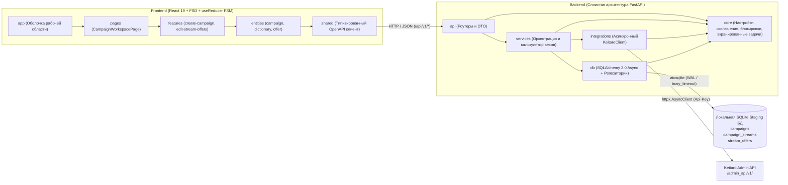

[English](README.en.md) | [Русский](README.ru.md)

# Adrobot — Создаватор кампаний и Staging-редактор потоков для Keitaro

**Adrobot** — это full-stack платформа для автоматизации кампаний и staging-управления офферами в потоках трекера **Keitaro Admin API (`/admin_api/v1/`)**. Сервис предоставляет детерминированный процесс создания двухпоточных кампаний (**Создаватор**) и локальный staging-редактор (**Редактор**) для управления ротацией офферов, фиксации (pin) весов трафика, архивации/восстановления офферов и атомарной публикации проверенных долей трафика обратно в Keitaro.

---

## Архитектурные решения и инженерная мотивация (Engineering Intent & Design Rationale)

Базовое техническое задание требовало лишь создания рабочей обёртки над Keitaro API. Однако данная реализация сфокусирована на паттернах надёжности, критически необходимых при автоматизации боевого трекера трафика, чей HTTP API не является транзакционным:

1. **Локальный Staging-слой в SQLite вместо прямых мутаций (Local Staging Layer):** Редактирование весов офферов напрямую в живом трекере чревато ошибками и финансовыми потерями. SQLite выступает буфером промежуточного состояния (`is_dirty`), сохраняя снапшоты последней публикации (`published_share`, `published_status`) и мягко архивируя удалённые офферы (`removed`). Операторы могут безопасно экспериментировать с весами, восстанавливать удалённые офферы (`BRING BACK`) или сбрасывать черновики (`CANCEL`) локально до тех пор, пока проверенная конфигурация не будет атомарно отправлена в трекер (`PUSH TO KT`).
2. **Компенсирующая согласованность для многошаговых внешних вызовов (Compensating Consistency):** Создание кампании в Keitaro требует 3 последовательных HTTP-запросов (`POST campaigns` + 2× `POST streams`). Чтобы предотвратить появление полусозданных «осиротевших» кампаний при сетевых сбоях или обрыве соединения клиентом, создание выполняется внутри экранированной асинхронной задачи с автоматической компенсирующей очисткой (`DELETE campaigns/{id}`) при возникновении ошибки на любом промежуточном шаге.
3. **Сквозная защита от состояний гонки и повторных кликов (End-to-End Concurrency & Double-Click Protection):** Интерфейс управляет мутациями потоков через детерминированный конечный автомат на базе `useReducer` (блокируя параллельные действия оператора, пока запросы находятся в процессе выполнения). На бэкенде это дополнено блокировками на уровне отдельных потоков и сверкой снапшотов состояния при вызове `PUSH`, что полностью исключает коллизии параллельных изменений (TOCTOU).
4. **Единый источник истины для контрактов и математики (Single Source of Truth):** Алгоритм целочисленного перераспределения весов и поддержания инвариантов (строгая сумма `sum == 100%`, минимальная доля `1%` на каждый активный оффер) изолирован в чистом доменном модуле, покрытом unit-тестами. Типы данных API для фронтенда генерируются напрямую из спецификации OpenAPI фреймворка FastAPI, исключая рассинхронизацию контрактов.

---

## 1. Обзор и архитектура

Adrobot спроектирован как асинхронный модульный монолит на бэкенде (**Python 3.12+ / FastAPI / SQLAlchemy 2.0 / Pydantic v2 / HTTPX**) в сочетании с одностраничным приложением (SPA) на фронтенде (**React 19 / TypeScript / Vite 6**), организованным по методологии **Feature-Sliced Design (FSD)**.



### Строгие архитектурные границы
- **Backend (`backend/src/adrobot/`):**
  - `api` -> `services`, `core` (роутеры FastAPI не выполняют прямых запросов к БД или внешних HTTP-вызовов).
  - `services` -> `integrations`, `db`, `core` (чистая доменная оркестрация, перераспределение весов и гарантированная целостность через экранированные задачи).
  - `integrations` -> `core` (типизированный `KeitaroClient` с автоматической нормализацией завершающего слэша в base URL и безопасной инкапсуляцией секретов через `pydantic.SecretStr`).
  - `db` -> `core` (асинхронные модели и репозитории SQLAlchemy 2.0 с явными вызовами `select()` / `selectinload()` без неявной ленивой загрузки).
  - `core` -> исключительно стандартная библиотека Python и системные утилиты.
- **Frontend (`frontend/src/`):**
  - Контроль зависимостей обеспечивается правилами `eslint-plugin-boundaries` (`app -> pages -> widgets -> features -> entities -> shared`).
  - Сложные жизненные циклы UI описываются детерминированными конечными автоматами на `useReducer` (`idle | loading | submitting | ready | error`), исключая разрозненные булевы флаги состояния.
  - Контракты данных строго типизированы на основе схемы OpenAPI бэкенда (`src/shared/api/schema.d.ts`).

### Схема локальной Staging базы данных
1. **`campaigns`**: Хранит созданные и управляемые кампании (`keitaro_campaign_id`, `name`, `alias`, `geo`, `domain_id`, `group_id`, `traffic_source_id`).
2. **`campaign_streams`**: Хранит потоки каждой кампании (`keitaro_stream_id`, `name`, `position`, `stream_type`, `schema`, `action_type`, `action_payload`, `has_offers`, `is_dirty`).
3. **`stream_offers`**: Хранит подготовленные (staged) и опубликованные состояния офферов потока (`keitaro_offer_id`, `offer_name`, `share`, `is_pinned`, `status` [`active` | `removed`], `is_published`, `published_share`, `published_status`) с уникальным ограничением по составному ключу `(stream_id, keitaro_offer_id)`.

---

## 2. Ключевая бизнес-логика и механика Staging

### A. Процесс создания кампании («Создаватор»)
Создание кампании (`POST /api/v1/campaigns`) выполняет строго упорядоченную последовательность из трёх шагов в Keitaro внутри экранированной задачи (`run_shielded`), защищая от разрыва сетевого соединения клиентом:
1. **`POST campaigns`**: Создаёт кампанию в Keitaro (`type = "position"`, `state = "active"`, `cost_type = "CPC"`, с привязкой к `domain_id = 1813`, `group_id = 10332`, `traffic_source_id = 836` и префиксом песочницы `test_bullo_`).
2. **`POST streams` — Поток 1 (`position = 1`, `Geo -> Google`)**:
   - `type = "regular"`, `schema = "redirect"`, `action_type = "http"`, `action_payload = "https://google.com/"`.
   - `filters = [{"name": "country", "mode": "accept", "payload": ["AU", ...]}]` с предварительной нормализацией и дедупликацией двухбуквенных кодов ISO 3166-1 alpha-2.
   - Сохраняется в локальной БД с флагом `has_offers = False` и отображается как компактная информационная плашка без возможности добавления офферов.
3. **`POST streams` — Поток 2 (`position = 2`, `Offers`)**:
   - `type = "default"`, `schema = "landings"`, `action_type = "http"`.
   - `offers = [{"offer_id": initial_offer_id, "share": 100, "state": "active"}]`.
   - Сохраняется в локальной БД с `has_offers = True`, `is_dirty = False`, а стартовый оффер помечается `is_published = True`, `published_share = 100`.
4. **Автоматическая компенсация (Automatic Compensation):** Если создание Потока 1, Потока 2 или коммит в SQLite завершились ошибкой после успешного `POST campaigns`, сервис автоматически выполняет компенсирующий запрос `DELETE campaigns/{id}` в Keitaro, предотвращая появление неполных («осиротевших») кампаний на трекере.

### B. Жизненный цикл Staging-редактора потоков («Редактор»)
Все манипуляции с офферами сначала сохраняются исключительно в локальном слое SQLite (`is_dirty = True`, подсвечивается жёлтым цветом в интерфейсе) до момента явной отправки по кнопке `PUSH TO KT` или отката по кнопке `CANCEL`:

| Действие | Эндпоинт | Поведение в Staging |
| :--- | :--- | :--- |
| **`FETCH STREAMS FROM KT`** | `POST /api/v1/campaigns/{id}/streams/fetch` | Загружает актуальные потоки из `GET campaigns/{id}/streams`. Опубликованные локальные офферы, отсутствующие в Keitaro, **не удаляются** — они переводятся в `status = "removed"`, `share = 0`, `is_pinned = False`, оставаясь доступными для `BRING BACK`. Неопубликованные локальные черновики (`is_published == False`), отсутствующие в Keitaro, удаляются из БД. |
| **`ADD OFFER`** | `POST /api/v1/streams/{id}/offers` | Добавляет новый оффер (`status = "active"`, `is_published = False`, `is_pinned = False`), переводит поток в `is_dirty = True` и автоматически пересчитывает доли активных офферов. |
| **`PIN` / Изменение доли** | `POST /api/v1/streams/{id}/offers/{offer_id}/pin` | Переключает признак `is_pinned` (если `share` не передан) либо фиксирует оффер с точной целочисленной долей `1 <= share <= 100`, перераспределяя остаток между незафиксированными активными офферами. |
| **`REMOVE`** | `POST /api/v1/streams/{id}/offers/{offer_id}/remove` | Выставляет `status = "removed"`, `share = 0`, `is_pinned = False`, переводит поток в `is_dirty = True` и перераспределяет `100%` между оставшимися активными офферами (со сбросом фиксации, если все оставшиеся активные офферы зафиксированы и не дают в сумме `100%`). |
| **`BRING BACK`** | `POST /api/v1/streams/{id}/offers/{offer_id}/bring-back` | Возвращает локально удалённый оффер обратно в состояние `status = "active"`, `is_pinned = False`, выставляет `is_dirty = True` и пересчитывает веса. |
| **`CANCEL`** | `POST /api/v1/streams/{id}/cancel` | Удаляет локальные черновики (`is_published == False`), восстанавливает ранее опубликованные офферы (`is_published == True`) к их снапшоту (`published_share`, `published_status`), сбрасывает фиксации и сбрасывает `is_dirty = False`. |
| **`PUSH TO KT`** | `POST /api/v1/streams/{id}/push` | Валидирует активные офферы (`count >= 1`, `sum(shares) == 100`, у каждого активного `share >= 1`), отправляет в Keitaro `PUT streams/{id}` **только офферы со статусом `active`**, обновляет локальные снапшоты `published_*` и сбрасывает `is_dirty = False`. Локально удалённые офферы остаются в SQLite для возможности последующего `BRING BACK`. |

### C. Детерминированный алгоритм распределения весов
Реализован в модуле `backend/src/adrobot/services/weights.py`:
- Доли всех активных офферов (`status == "active"`) выражаются целыми числами и строго суммируются ровно в **`100%`**. Для удалённых офферов всегда действуют значения `share = 0` и `is_pinned = False`.
- Зафиксированные активные офферы (`is_pinned == True`) сохраняют свой точный `share`.
- Оставшаяся часть трафика `remaining = 100 - sum(pinned_shares)` делится между `count = len(unpinned_active)` незафиксированными активными офферами:
  - Каждый незафиксированный активный оффер получает базовую долю `remaining // count`.
  - Остаток от целочисленного деления `remaining % count` начисляется **последнему** незафиксированному активному офферу (например, для 3 офферов веса составят `33%`, `33%`, `34%`).
- **Защита минимальной доли 1% (Minimum 1% Guard):** Каждый незафиксированный активный оффер обязан получить как минимум `1%` (`remaining >= len(unpinned_active)`). Попытка добавить или вернуть оффер при уже зафиксированных `100%` немедленно отклоняется с ошибкой `422 Unprocessable Entity` вместо генерации невалидного активного оффера с `0%`.

---

## 3. Быстрый запуск

### Вариант А: Запуск одной командой через Docker Compose (Рекомендуется)

1. **Создайте файл `.env` на основе шаблона:**
   ```bash
   cp .env.example .env
   ```
   Откройте `.env` и укажите параметры `KEITARO_API_URL` (или `KEITARO_BASE_URL`) и `KEITARO_API_KEY`.

2. **Соберите и запустите стек сервисов:**
   ```bash
   docker compose up --build
   ```
   - **Пользовательский веб-интерфейс (Nginx SPA + проксирование `/api/`):** http://localhost:8080
   - **Backend API и Swagger-документация:** http://localhost:8000/docs
   - **Эндпоинт проверки работоспособности (Healthcheck):** http://localhost:8080/health (через Nginx) или http://localhost:8000/health
   - При старте контейнер `backend` автоматически выполняет `uv run --no-sync alembic upgrade head` для персистентного тома `adrobot_sqlite_data` (`/app/data/adrobot.db`) перед запуском веб-сервера `uvicorn` (`--workers 1` под непривилегированным пользователем `appuser`).

3. **Остановка стека:**
   ```bash
   docker compose down
   ```

---

### Вариант Б: Ручной локальный запуск для разработки

#### 1. Бэкенд (`backend/`)
Требуется **Python 3.12+** и пакетный менеджер **[uv](https://docs.astral.sh/uv/)**.

```bash
cd backend

# 1. Создайте локальный файл переменных окружения
cp .env.example .env
# Отредактируйте backend/.env, указав KEITARO_API_URL и KEITARO_API_KEY

# 2. Установите зависимости из зафиксированного lock-файла
uv sync --frozen

# 3. Примените миграции базы данных Alembic к локальной SQLite (adrobot.db)
uv run alembic upgrade head

# 4. Запустите сервер разработки FastAPI на порту 8000
uv run uvicorn adrobot.main:app --reload --host 127.0.0.1 --port 8000
```

#### 2. Фронтенд (`frontend/`)
Требуется **Node.js 22+**.

```bash
cd frontend

# 1. Установите зависимости
npm install

# 2. Запустите dev-сервер Vite на http://localhost:3000 (проксирует /api и /health на 127.0.0.1:8000)
npm run dev
```

---

## 4. Quality Gates и тестирование

И для бэкенда, и для фронтенда действуют строгие автоматизированные проверки качества с требованием нулевого уровня ошибок и предупреждений.

### Quality Gate бэкенда (`cd backend`)
```bash
# 1. Линтинг (ruff: pycodestyle, pyflakes, isort, pyupgrade, bugbear, simplify, async, bandit)
uv run ruff check .

# 2. Проверка форматирования кода
uv run ruff format --check .

# 3. Строгая статическая типизация
uv run pyright

# 4. Модульные и интеграционные тесты (40 тестов: веса, репозитории, MockTransport для Keitaro, API-сценарии)
uv run pytest
```

### Quality Gate фронтенда (`cd frontend`)
```bash
# 1. ESLint (строгий TypeScript + проверка архитектурных слоёв FSD)
npm run lint

# 2. Проверка типов компилятором TypeScript
npm run typecheck

# 3. Production-сборка бандла Vite
npm run build

# 4. Перегенерация типов TypeScript OpenAPI из запущенного бэкенда (http://127.0.0.1:8000/openapi.json)
npm run gen:api
```

### Валидация конфигурации Docker Compose (в корне репозитория)
```bash
docker compose config --no-interpolate
```
